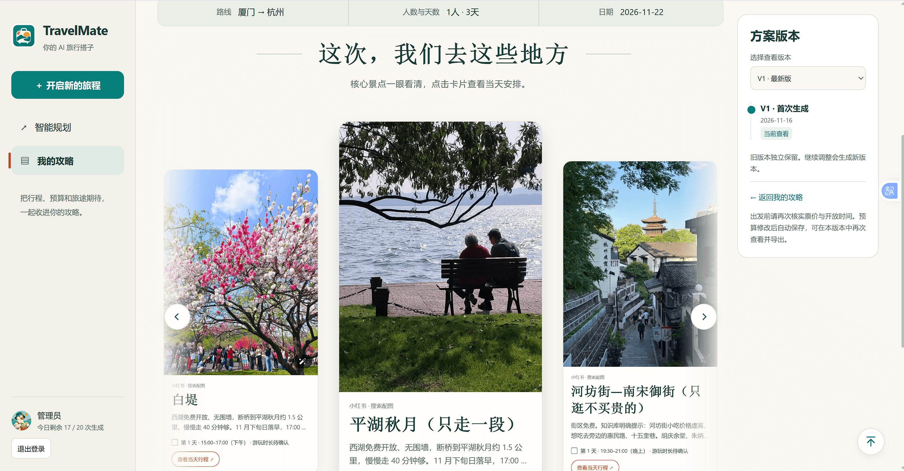

<p align="center">
  
</p>

<p align="center">
  
  
  
  
  
  
</p>

<p align="center">
  <a href="Readme.md">中文</a> | <strong>English</strong>
</p>

<h1 align="center">TravelMate — AI Travel Planner</h1>

## Introduction

TravelMate is a travel-planning agent built with LangChain / LangGraph, FastAPI, plain HTML/CSS/JS and SQLite. It collects trip requirements through a homepage form, shows the actual generation stages, and opens the guide when complete. Users can refill the form to create a new version or use chat for complex requirements. It researches guides and places, checks structured itineraries, and saves versioned travel guides.

Built for travelers organizing a trip and developers exploring tool calling, persistent state and structured itinerary validation.

Example: **“Two people travelling from Shanghai to Hangzhou for three days. Total budget: CNY 3,000, including accommodation, meals, tickets and local transport, excluding return train fares. We like nature and local food; dates are undecided.”** Dates and origin are optional; an undated trip uses relative days.


## Highlights

- **Requirements to a complete guide**: submit destination, duration, travelers, budget and preferences through a form, follow actual generation stages and open the result directly. Use chat for complex requirements.
- **Seven guide sections**: overview, budget, daily itinerary, accommodation, local food, pitfalls and preparation in a responsive desktop and mobile interface.
- **Research from multiple sources**: optional Xiaohongshu notes, local Markdown / Bailian knowledge, DeepSeek / Tavily search, Amap place and weather tools, and a self-hosted 12306 MCP integration.
- **Editable, explicit budgets**: distinguish estimates, query results and unknown amounts. Edit category amounts and inclusion toggles; saved changes carry into exports.
- **Versions that preserve usable plans**: revisions create new versions and failed revisions keep the previous plan. My Guides supports search, favorites, renaming and history; guides remain after chats are deleted.
- **Guides to take with you**: export PDF, Markdown or self-contained HTML with embedded assets. Manage preparation checklists online or in offline HTML.

## Features

| Guide section | Implemented behavior |
| --- | --- |
| Overview | Portrait scenic carousel with arrows, keyboard and swipe navigation, daily links and saved-version details; shares images with the daily itinerary and filters routine transport, meals, accommodation and rest from new plans |
| Budget | Category totals, per-person costs and remaining budget; editable amounts, inclusion toggles, filters, sorting and reset |
| Daily itinerary | Daily activity cards, transport estimates, weather, schematic maps and saved rain alternatives |
| Accommodation | Area comparisons covering suitability, transport, trade-offs, reference budgets and booking checks |
| Local food | Image cards for representative local dishes and snacks, flavor descriptions and ordering tips; filters attraction names, restaurant names and generic meal placeholders, without grouping by day or meal |
| Pitfalls | Reminders by travel stage, with the saved itinerary's specific advice retained |
| Preparation | Categorized editable checklists, filters and progress; online changes saved per account, session and plan version |

The responsive interface uses bundled city, scenery and AI-generated reference assets when photos are unavailable; it does not automatically generate photos at runtime.

Additional capabilities include invitation-based accounts, daily quotas, persistent chat history, editable voice transcription and pre-departure checks. Checks require the web service and scheduler to be running, report changes within the configured window and do not rewrite the itinerary automatically.

## Demo screenshots

### Homepage


### Planning progress


### Trip overview



### Daily itinerary


### Trip preparation


## Tech stack

| Layer | Technology | Purpose |
| --- | --- | --- |
| Agent and workflow | LangChain, LangGraph | Models, tools, planning state and conversation checkpoints |
| Backend | Python 3.11+, FastAPI, Uvicorn | Web service, API, accounts and planning tasks |
| Frontend | Plain HTML / CSS / JavaScript | Forms, guides, carousels and checklists; no frontend build step |
| Storage | SQLite | Accounts, sessions, guide versions and user edits |
| Model access | DeepSeek by default; configurable compatible endpoints | Requirements, itinerary generation and optional semantic review |
| Research and tools | DeepSeek Search / Tavily, Amap, Bailian, Xiaohongshu, 12306 MCP | Optional research, places, weather and transport data |
| Exports | ReportLab, Markdown, HTML | PDF, Markdown and standalone HTML guides |

## Project structure

Main directories and entry points; some business modules, styles and scripts are omitted.

```text
travelmate-agent/
├── travelmate/            # Application code
│   ├── api.py               # FastAPI entry point and web API
│   ├── agent.py             # Model access and agent entry point
│   ├── planner.py           # Explicit planning stages and orchestration
│   ├── workflow.py          # Planning state, schemas and itinerary checks
│   ├── tools.py             # Search, places, routes and budget tools
│   ├── knowledge.py         # Local / Bailian knowledge retrieval
│   ├── library.py           # Guide library, favorites and history
│   ├── pdf_export.py        # PDF export
│   ├── index.html           # Planning homepage
│   ├── library.html         # Guide library page
│   ├── images/              # Icon and bundled reference assets
│   ├── prompts/             # Model prompts
│   └── vendor/              # Third-party assets and license notices
├── docs/                  # Feature, configuration and design notes; screenshots
├── knowledge/             # Local Markdown travel knowledge
├── scripts/               # Knowledge and speech integration utilities
├── tests/                 # Python and frontend regression tests
├── .env.example           # Example environment settings without private keys
├── pyproject.toml         # Dependencies, optional extras and CLI entry point
├── uv.lock                # Dependency lockfile
├── Readme.md              # Chinese README
└── README.en.md           # English README
```

Runtime data defaults to `data/`; exports and temporary files are generated as needed and are separate from the source tree.

## Run locally

Install Python 3.11+ and [uv](https://docs.astral.sh/uv/). From the project root in PowerShell:

```powershell
uv sync --extra dev
Copy-Item .env.example .env
```

Keep an existing `.env` rather than replacing it. Set `MODEL_API_KEY`, `MODEL_NAME` and `MODEL_BASE_URL`; defaults target DeepSeek. Set `AUTH_COOKIE_SECURE=false` for local HTTP and `true` for public HTTPS. Keep credentials and private data out of Git.

```powershell
uv run python -m travelmate.accounts invite
uv run uvicorn travelmate.api:app --host 127.0.0.1 --port 8000
```

Open the [local login page](http://127.0.0.1:8000/login), register with the invite code and fill in the homepage trip form. Use the guide page to change requirements and generate a new version, or add complex requirements through chat. For CLI usage, run `uv run travelmate --session demo`; reuse the session ID to continue, and type `/exit` to quit.

Optional integrations use the `aliyun`, `xhs` and `rail` extras. Include the required extras in both `uv sync` and subsequent `uv run` commands. Local speech recognition requires a separate `faster-whisper` installation. See [.env.example](.env.example) and the [Chinese configuration table](Readme.md#可选配置) for settings. Restart the service after changing configuration, and persist and back up the SQLite database.

## Limits

Budget edits are saved automatically for that account and guide version: amounts save about half a second after typing stops, while inclusion toggles and resetting plan amounts save immediately. Saved edits appear on reopening and in PDF / Markdown / HTML exports; they are user-entered figures, not verified quotes. Rain alternatives remain route previews; request a revised plan in chat to save an itinerary change.

Reference images are illustrative, and images are not generated automatically at runtime. Accommodation suggestions do not provide live availability or automatic booking. Map lines are schematic; place lookup does not verify walking or transit times. Weather requires a date and valid query results, and third-party train results do not guarantee availability.

Online checklists can be read across devices under the same account. Offline HTML checklists use browser storage and do not sync back to the account. External service reliability, planning quality and costs need separate real-world validation.

## Development

Run `uv run --extra dev pytest -q` for Python regressions. Node.js is needed for JavaScript tests and some Python interaction checks; run `node --test tests/markdown.test.mjs tests/quick-fill.test.mjs tests/auth.test.mjs tests/voice.test.mjs` for frontend tests. Run `git diff --check` to check whitespace. Mocked tests do not verify live external services.

## Documentation

| Document | Content (Chinese) |
| --- | --- |
| [Form planning](docs/form-planning.md) | Form requirements, execution stages and replanning |
| [Planning workflow](docs/planning-workflow.md) | Planning, evidence, versions and failure handling |
| [My Guides](docs/my-guides.md) | Saved guides, favorites and history |
| [Accounts and access](docs/invitation-access.md) | Invitations, login, quotas and deployment |
| [Preparation](docs/preparation.md) | Checklist persistence and offline limits |
| [Configuration](.env.example) | Model access, tools and runtime options |
| [More documents](Readme.md#更多文档) | Architecture, images, knowledge and integration notes |

Some documents record earlier stages; this README and the current implementation describe current behavior.
