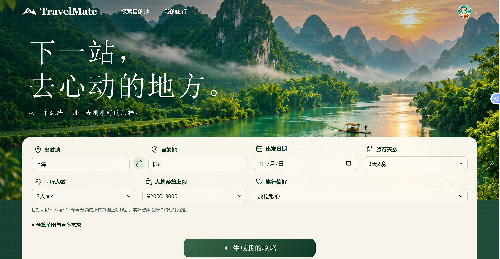
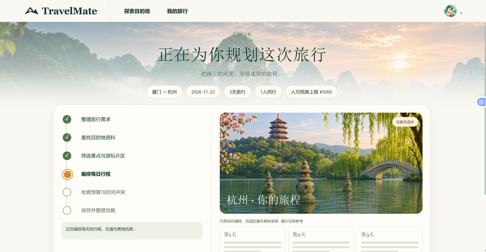
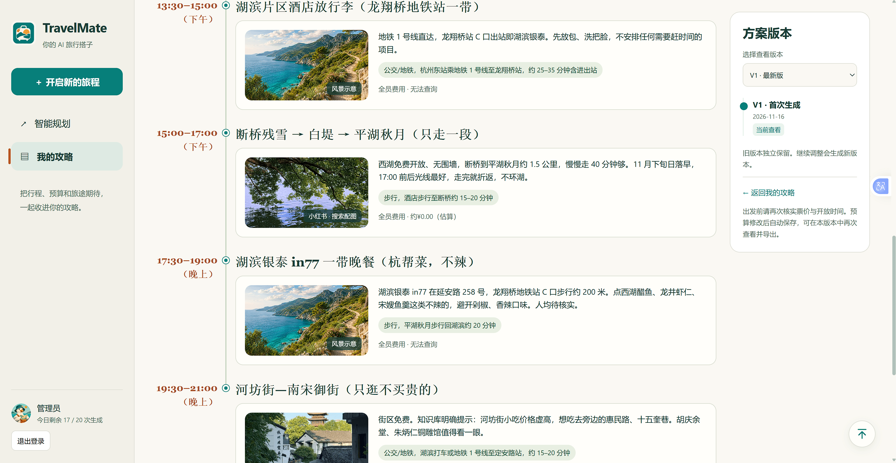
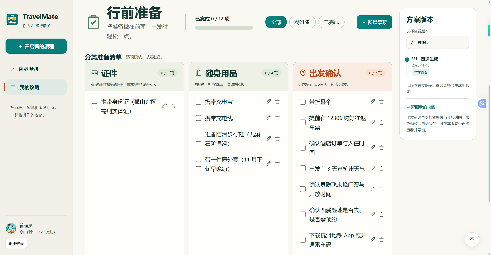

<p align="center">
  
</p>

<p align="center">
  
  
  
  
  
  
</p>

<p align="center">
  <a href="Readme.md">中文</a> | <strong>English</strong>
</p>

<h1 align="center">TravelMate — AI Travel Planner</h1>

TravelMate is a travel-planning agent built with LangChain / LangGraph, FastAPI, plain HTML/CSS/JS and SQLite. It collects trip requirements through a homepage form, shows the actual generation stages, and opens the guide when complete. Users can refill the form to create a new version or use chat for complex requirements. It researches guides and places, checks structured itineraries, and saves versioned travel guides.

Example: **“Two people travelling from Shanghai to Hangzhou for three days. Total budget: CNY 3,000, including accommodation, meals, tickets and local transport, excluding return train fares. We like nature and local food; dates are undecided.”** Dates and origin are optional; an undated trip uses relative days.

## Current features

| Guide section | Implemented behavior |
| --- | --- |
| Overview | Portrait scenic carousel with arrows, keyboard and swipe navigation, daily links and saved-version details; shares images with the daily itinerary and filters routine transport, meals, accommodation and rest from new plans |
| Budget | Category totals, per-person costs and remaining budget; editable amounts, inclusion toggles, filters, sorting and reset |
| Daily itinerary | Daily activity cards, transport estimates, weather, schematic maps and saved rain alternatives |
| Accommodation | Area comparisons covering suitability, transport, trade-offs, reference budgets and booking checks |
| Local food | Image cards for representative local dishes and snacks, flavor descriptions and ordering tips; filters attraction names, restaurant names and generic meal placeholders, without grouping by day or meal |
| Pitfalls | Reminders by travel stage, with the saved itinerary's specific advice retained |
| Preparation | Categorized editable checklists, filters and progress; online changes saved per account, session and plan version |

The responsive UI includes bundled city, scenery and AI-generated reference assets. Other capabilities include local Markdown or Bailian knowledge retrieval, optional Xiaohongshu research, DeepSeek / Tavily search, Amap tools, a self-hosted 12306 MCP integration, editable voice transcription, invitation-based accounts and pre-departure checks while the web service is running.

Each saved guide supports PDF, Markdown and standalone HTML exports. Failed revisions keep the previous usable plan. Programmatic validation is enabled by default; model-based review is optional.

## Limits

Budget edits are saved automatically for that account and guide version: amounts save about half a second after typing stops, while inclusion toggles and resetting plan amounts save immediately. Saved edits appear on reopening and in PDF / Markdown / HTML exports; they are user-entered figures, not verified quotes. Rain alternatives remain route previews; request a revised plan in chat to save an itinerary change.

Reference images are illustrative, and images are not generated automatically at runtime. Accommodation suggestions do not provide live availability or automatic booking. Map lines are schematic; place lookup does not verify walking or transit times. Weather requires a date and valid query results, and third-party train results do not guarantee availability.

Online checklists can be read across devices under the same account. Offline HTML checklists use browser storage and do not sync back to the account. External service reliability, planning quality and costs need separate real-world validation.

## Run locally

Install Python 3.11+ and [uv](https://docs.astral.sh/uv/). From the project root in PowerShell:

```powershell
uv sync --extra dev
Copy-Item .env.example .env
```

Keep an existing `.env` rather than replacing it. Set `MODEL_API_KEY`, `MODEL_NAME` and `MODEL_BASE_URL`; defaults target DeepSeek. Set `AUTH_COOKIE_SECURE=false` for local HTTP and `true` for public HTTPS. Keep credentials and private data out of Git.

```powershell
uv run python -m travelmate.accounts invite
uv run uvicorn travelmate.api:app --host 127.0.0.1 --port 8000
```

Open the [local login page](http://127.0.0.1:8000/login), register with the invite code and fill in the homepage trip form. Use the guide page to change requirements and generate a new version, or add complex requirements through chat. For CLI usage, run `uv run travelmate --session demo`; reuse the session ID to continue, and type `/exit` to quit.

Optional integrations use the `aliyun`, `xhs` and `rail` extras. Include the required extras in both `uv sync` and subsequent `uv run` commands. Local speech recognition requires a separate `faster-whisper` installation. See [.env.example](.env.example) and the [Chinese configuration table](Readme.md#可选配置) for settings. Restart the service after changing configuration, and persist and back up the SQLite database.

## Demo screenshots

### Homepage



### Planning progress



### Trip overview


### Daily itinerary



### Trip preparation



## Development

Run `uv run --extra dev pytest -q` for Python regressions. Node.js is needed for JavaScript tests and some Python interaction checks; run `node --test tests/markdown.test.mjs tests/quick-fill.test.mjs tests/auth.test.mjs tests/voice.test.mjs` for frontend tests. Run `git diff --check` to check whitespace. Mocked tests do not verify live external services.

The [Chinese documentation table](Readme.md#更多文档) links to architecture, workflow, account, checklist, image asset, knowledge-base, weather and railway setup notes in Chinese. Some documents record earlier implementation stages.
