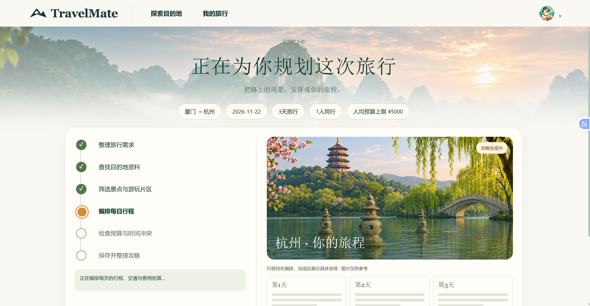
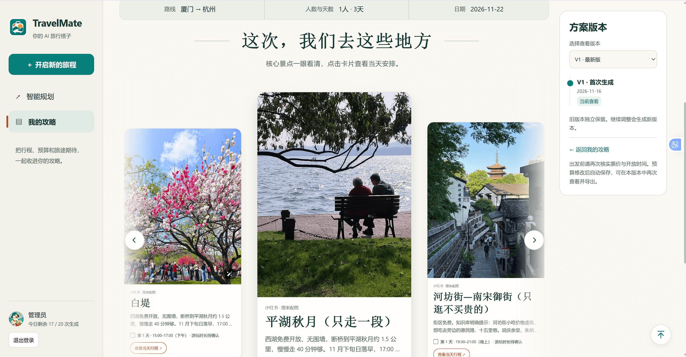
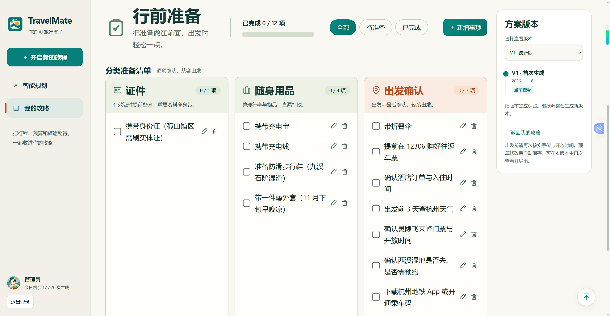

<p align="center">
  
</p>

<p align="center">
  
  
  
  
  
  
</p>

<p align="center">
  <strong>中文</strong> | <a href="README.en.md">English</a>
</p>

<h1 align="center">TravelMate — AI 旅行规划助手</h1>

## 项目简介

TravelMate 是基于 LangChain / LangGraph 的旅行规划智能体，使用 FastAPI、原生 HTML/CSS/JS 和 SQLite。通过首页表单选择旅行条件，查看真实生成阶段，完成后直接打开攻略；支持回填条件生成新版本，也保留对话补充复杂需求。结合攻略、联网搜索和地点查询，生成可查看、继续修改和导出的旅行方案。

适合希望快速整理出行方案的旅行者，也适合学习工具调用、状态持久化和结构化行程校验的开发者。

例如：**“从上海去杭州，2 人玩 3 天，全员总预算 3000 元人民币，包含住宿、餐饮、门票和市内交通，不含往返高铁，喜欢自然风景和当地美食，日期暂定。”**

日期未定也可以规划，页面按“第几天”展示；日期确定后再查询对应天气和票务信息。费用区分估算、查询结果与未知金额，不把未查到价格当作免费。

## 核心亮点

- **从条件到完整攻略**：通过表单填写目的地、天数、人数、预算和偏好，查看真实生成阶段，完成后直接进入攻略；也能用对话补充复杂需求。
- **七个板块集中呈现**：行程概览、预算明细、每日行程、住宿推荐、当地美食、避坑指南和行程准备，兼顾桌面浏览与手机出行查看。
- **多来源资料辅助规划**：支持小红书笔记、本地 Markdown / 阿里云百炼知识库、DeepSeek / Tavily 搜索，以及高德地点、天气和自部署 12306 MCP 查询；按需配置启用。
- **预算可调整、金额有边界**：区分估算、查询结果与未知金额，支持分类查看、修改金额和计入开关；修改自动保存，并带入导出文件。
- **修改有版本，失败有保留**：重新规划保存新版本，失败时保留上一版可用方案；“我的攻略”支持搜索、收藏、重命名和历史版本，删除聊天后攻略仍保留。
- **攻略可带走**：支持 PDF、Markdown 和内嵌素材的单文件 HTML 导出；行前准备清单可在线管理，也可在离线 HTML 中使用。

## 功能概览

### 七个攻略板块

| 板块 | 当前功能 |
| --- | --- |
| 行程概览 | 景点竖图轮播、按天进入日程、方案版本与来源说明；支持箭头、键盘和手机滑动，与每日行程复用图片，过滤普通交通、用餐、住宿与休息 |
| 预算明细 | 分类费用、全员与人均金额、预算余量；支持修改金额、勾选计入、分类筛选、排序和恢复方案金额 |
| 每日行程 | 按天查看景点卡片、交通预留、费用和提醒；查看天气、地点地图及已生成的普通雨天备选路线 |
| 住宿推荐 | 按片区比较适合人群、交通、区域取舍与参考预算，结合行程动线展示，并提示取消条款、房型和到站交通 |
| 当地美食 | 通过图片卡片浏览目的地代表性菜品和小吃，查看风味介绍与点单提醒；过滤景点、餐厅名称与泛泛用餐占位建议，不按天或餐次分组 |
| 避坑指南 | 按预订前、出发前、游玩中、返程前查看通用提醒，并保留该方案已有的专项避坑内容 |
| 行程准备 | 按类别管理准备事项，支持勾选、新增、修改、删除、状态筛选及进度统计；在线按账号、会话和方案版本保存 |

页面采用奶油白、墨绿与橙色配色，适配桌面和手机。内置城市、风景及 AI 生成的住宿、美食参考素材，用于缺少照片时的示意展示；运行时不会自动生成真实景点或酒店照片。

### 配套能力

- **账号与会话**：邀请码注册、登录、每日额度、历史会话、置顶和多选删除，数据持久化到 SQLite。
- **语音输入**：录音转成可编辑文字，确认发送后进入规划流程。
- **行前复核**：网页服务运行且定时检查启用时，在配置的出发前窗口重新查询部分资料、报告变化，不自动改写行程。

## 运行演示图










## 技术栈

| 层次 | 技术 | 用途 |
| --- | --- | --- |
| 智能体与工作流 | LangChain、LangGraph | 模型与工具调用、规划状态、会话检查点 |
| 后端服务 | Python 3.11+、FastAPI、Uvicorn | 网页服务、接口、账号与规划任务 |
| 网页交互 | 原生 HTML / CSS / JavaScript | 表单、攻略展示、轮播与清单，无需前端构建 |
| 数据存储 | SQLite | 账号、会话、攻略版本及用户修改 |
| 模型接入 | 默认 DeepSeek，兼容接口可配置 | 需求理解、行程生成与可选语义复核 |
| 资料与工具 | DeepSeek Search / Tavily、高德、百炼、小红书、12306 MCP | 按需接入检索、地点、天气与交通资料 |
| 文档交付 | ReportLab、Markdown、HTML | PDF、Markdown 与单文件 HTML 导出 |

## 目录结构

以下为主要目录与入口，省略部分业务模块和样式脚本。

```text
travelmate-agent/
├── travelmate/            # 应用代码
│   ├── api.py               # FastAPI 入口与网页接口
│   ├── agent.py             # 模型接入与智能体入口
│   ├── planner.py           # 显式规划阶段与流程编排
│   ├── workflow.py          # 规划状态、数据模型与行程校验
│   ├── tools.py             # 搜索、地点、路线与预算工具
│   ├── knowledge.py         # 本地 / 百炼知识库检索
│   ├── library.py           # 攻略库、收藏与历史版本
│   ├── pdf_export.py        # PDF 导出
│   ├── index.html           # 规划首页
│   ├── library.html         # 攻略库页面
│   ├── images/              # 图标及内置参考素材
│   ├── prompts/             # 模型提示词
│   └── vendor/              # 第三方素材及其许可说明
├── docs/                  # 功能、配置与设计文档，含演示截图
├── knowledge/             # 本地 Markdown 攻略资料
├── scripts/               # 知识库及语音接入辅助脚本
├── tests/                 # Python 与前端回归测试
├── .env.example           # 环境变量示例，不含私人密钥
├── pyproject.toml         # 依赖、可选集成与命令行入口
├── uv.lock                # 依赖锁定文件
├── Readme.md              # 中文说明
└── README.en.md           # 英文说明
```

运行时数据默认写入 `data/`，导出及临时文件按使用方式生成；这些本地文件不属于源代码目录。

## 本地运行

需要 Python 3.11+ 和 [uv](https://docs.astral.sh/uv/)。以下命令使用 PowerShell，在项目根目录执行。

```powershell
uv sync --extra dev
Copy-Item .env.example .env
```

已有 `.env` 时保留原配置。至少设置 `MODEL_API_KEY`，其余默认项可参考 `.env.example`：

```dotenv
MODEL_API_KEY=你的模型密钥
MODEL_NAME=deepseek-flash
MODEL_BASE_URL=https://api.deepseek.com
AUTH_COOKIE_SECURE=false
```

默认接入 DeepSeek，也可配置兼容接口的地址与模型名。模型及外部 API 的费用由所用服务决定。`.env`、账号数据库和私人会话不提交到 Git；本地 HTTP 使用 `AUTH_COOKIE_SECURE=false`，公网 HTTPS 部署设回 `true`。

### 启动网页

```powershell
uv run uvicorn travelmate.api:app --host 127.0.0.1 --port 8000
```

首次使用时生成邀请码：

```powershell
uv run python -m travelmate.accounts invite
```

打开 [本地网页](http://127.0.0.1:8000)，在 [登录页](http://127.0.0.1:8000/login) 使用邀请码注册，然后填写首页旅行表单开始规划。攻略页可点击“修改条件重新规划”生成新版本，也可以通过对话补充复杂需求。

### 命令行

```powershell
uv run travelmate --session demo
```

复用相同 `--session` 继续历史对话，输入 `/exit` 退出。

### 可选配置

| 变量 | 用途 |
| --- | --- |
| `SEARCH_PROVIDER` / `TAVILY_API_KEY` | `auto` 默认在配置 DeepSeek 官方网关与密钥时使用其搜索，否则选择 Tavily；可指定 `deepseek` 或 `tavily` |
| `AMAP_API_KEY` | 高德 Web 服务 Key，用于地点查询、天气及驾车路线工具 |
| `KNOWLEDGE_PROVIDER` / `KNOWLEDGE_DIR` | `local` 使用本地攻略，`aliyun` 使用百炼知识库；默认本地目录为 `knowledge` |
| `XHS_COOKIE` / `XHS_ENABLED` | 小红书笔记检索；Cookie 仅保存在服务端，接入方法见文档 |
| `RAIL_MCP_URL` | 自部署 12306 MCP 地址；未配置时尝试搜索参考交通信息 |
| `ASR_PROVIDER` / `ASR_API_KEY` / `ASR_BASE_URL` / `ASR_MODEL` | 语音转文字；支持兼容接口或需另行安装的本地 `faster-whisper` |
| `COST_MODE` | `research` 调研费用；`plan` 只规划流程，金额待核实 |
| `REVIEW_MODE` | 默认 `program`，只做程序检查；`full` 增加模型语义复核 |
| `PLAN_BUDGET_SECONDS` | 规划软时限，默认 55 秒；影响后续复核与重排，不保证请求在该秒数内返回 |
| `WATCH_SCHEDULER` / `WATCH_LEAD_DAYS` / `WATCH_INTERVAL_HOURS` | 行前复核开关、出发前窗口和同版复核间隔；默认启用、3 天、24 小时 |
| `DATABASE_PATH` | SQLite 文件位置，默认 `data/checkpoints.sqlite`；部署时使用持久存储并备份 |

百炼、小红书、铁路客户端分别需要 `aliyun`、`xhs`、`rail` 可选依赖，按需安装。例如同时启用三项：

```powershell
uv sync --extra dev --extra aliyun --extra xhs --extra rail
uv run --extra aliyun --extra xhs --extra rail uvicorn travelmate.api:app --host 127.0.0.1 --port 8000
```

后续 `uv run` 也应保留所需的可选依赖参数。修改 `.env` 后重启服务。完整配置和说明见 [.env.example](.env.example)。

## 使用边界

- **预算修改后自动保存**：金额停止输入约半秒后保存，勾选计入状态及恢复方案金额后立即保存，按账号、攻略版本保留；再次查看与 PDF / Markdown / HTML 导出会带上保存的金额和计入状态。用户填写金额不代表已核实报价；原始行程估算保留供参考。综合费用只有存在明确分项与金额依据时才拆分。
- **雨天切换用于查看备选路线**，预算、地图和 PDF / Markdown 导出仍对应原定行程；需要保存调整时，通过对话生成新版本。
- **图片是参考素材**，不代表对应目的地、酒店或菜品的真实照片。住宿建议不提供实时可订房态，也没有自动预订功能。
- **地点地图为坐标连线示意**。默认规划尚未完整接入关键路段的实时路线核验；地点存在性不能证明步行、公交或接驳耗时准确。
- **天气依赖日期与有效查询结果**。无日期时不查询天气；无结果或超出预报范围时不编造预报。第三方铁路查询结果不保证出票或余票。
- **在线与离线清单分别保存**。在线清单支持同账号跨设备读取；离线 HTML 的修改只保存在当前浏览器，不自动回传账号。清理浏览器数据会丢失离线修改。
- 小红书接入面向个人低频演示，失败时降级补查知识库。真实外部接口质量、成功率和调用成本仍需独立验收。

## 开发与验证

```powershell
# Python 回归测试
uv run --extra dev pytest -q

# 前端脚本测试，需要 Node.js
node --test tests/markdown.test.mjs tests/quick-fill.test.mjs tests/auth.test.mjs tests/voice.test.mjs

# 格式与空白检查
git diff --check
```

部分 Python 用例也通过 Node.js 验证页面交互。测试使用模拟模型与工具结果，不替代真实接口联调。轮播回归包含临近自动切换时手动翻页、完整 4 秒重新计时，以及离开视口或后台时暂停。

## 更多文档

| 文档 | 内容 |
| --- | --- |
| [表单规划](docs/form-planning.md) | 首页条件、执行阶段与重新规划 |
| [我的攻略](docs/my-guides.md) | 攻略库、收藏与版本管理 |
| [设计说明](docs/design.md) | 架构与模块划分 |
| [规划工作流](docs/planning-workflow.md) | 规划、证据、版本与失败保护的演进记录 |
| [邀请与账号](docs/invitation-access.md) | 登录、额度与部署 |
| [行前准备](docs/preparation.md) | 清单保存、版本隔离、冲突处理和离线限制 |
| [住宿参考图](docs/lodging-visuals.md) | 内置素材、生成提示词与旧方案兼容 |
| [避坑页面](docs/pitfalls-ui.md) | 阶段筛选、通用提醒与专项内容 |
| [小红书接入](docs/xiaohongshu.md) | Cookie、检索自检与降级 |
| [阿里云知识库](docs/aliyun-knowledge.md) | 百炼接入与标签过滤 |
| [12306 MCP](docs/12306-mcp-setup.md) | 铁路查询配置与排错 |
| [天气与工具](docs/weather-and-tool-options.md) | 天气能力及工具接入说明 |

工作流及阶段总结文档包含历史记录；当前页面行为以本 README 和实现为准。
