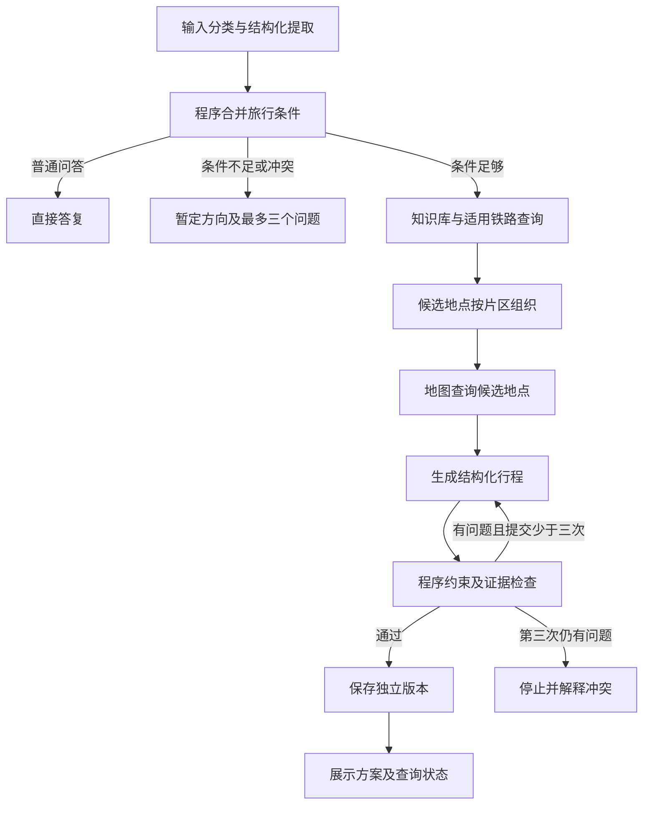

# 事实依据与显式规划工作流

实施日期：2026-11-03。第一步提交 `9b3c5d0`，第二步提交 `f8b799a`；第三步提交通过 Git 日志查询。

## 默认运行方式

`open_agent()`、网页和 CLI 默认使用显式 LangGraph。原工具循环通过 `legacy_tool_loop=True` 保留，供旧行为兼容测试使用，不作为默认路径。沿用 SQLite checkpoint 和同一会话 ID，无需新建会话数据库。

节点阶段、时间、尝试次数及当前状态保存在 `workflow.trace`。每个节点使用 LangGraph checkpoint 保存状态。中断时历史显示未完成，不产生完成事件；重启后可继续同一会话，也可用 `agent.invoke(None, config)` 从待执行节点恢复。服务错误返回简洁提示，不输出异常正文和凭据。

## 第二步：证据模型

真实工具结果由程序生成 evidence，模型只能引用，不能创建记录。记录包含工具名、调用 ID、参数、查询时间、适用日期、旅行条件指纹、具体事实及值、公开标题、安全链接和过期时间。查询成功匹配、空结果、失败、超范围分别保存；文档参考独立标记。未调用工具即没有记录，不能声称查询失败或已经核实。

- 地点查询只支持地点名称存在性，不支持营业时间或价格。
- 驾车路线只支持驾车耗时，不能证明步行/公交时间。
- 铁路完整票据结果须关联指定日期及当前条件，第三方 MCP 不代表官方出票保证。保守查询窗口为15天，实际以12306服务为准。
- 网页、知识库原文作为文档参考，不能当成本次实时票价查询。
- 铁路依据15分钟、驾车路线及文档参考1小时、地点存在性30天到期。这是首版保守策略，不保证在有效期内信息绝不变化。
- `Stop.fact_refs` 按 place/cost/opening_hours/travel_minutes 分别引用；无依据的费用继续展示为估算。当前未实现实时价格/营业时间提取，相关字段不能被自动核实。
- 结构化行程中的铁路代码必须有对应铁路结果；其他自由文本的语义事实仍需后续第四步审查，不能由正则检查保证真实。

引用检查同时用于默认工作流、兼容工具提交和原行程编辑/确认接口。来源摘要仍在原网页可折叠区域，保留匹配、失败和无结果状态；完整记录可通过既有 trip 接口读取。公开输出继续脱敏。

## 第三步：版本与失败保护

候选方案独立保存在 candidate；只有程序与证据检查通过才替换当前可用 plan。每个成功版本保存当时条件、费用、行程及依据 ID。变更条件后重新取证，旧依据因条件指纹不匹配不能为新方案背书。普通编辑接口也保存版本，失败编辑不覆盖有效 plan。

新一轮生成或修订失败，保留以前 plan 和 versions，当前运行状态明确为 failed/blocked，不能显示本轮成功。旧回答及其 PDF 使用对应消息正文，后续修改不改变原回答导出。

约束不齐时不会用 assumptions 中的预算进入最终校验。出发地和日期保持可选；缺失时采用相对天数，不查询缺参数车次。程序强制先检索、组织候选和核实地点，再生成、检查、有限修订和保存。普通问答不强制完整规划。

## 验证记录

- `.venv/Scripts/python.exe -m pytest -q`：56 项通过。
- `node --test tests/markdown.test.mjs tests/quick-fill.test.mjs`：20 项通过。
- `git diff --check`：通过。
- 旧工具循环测试显式使用兼容开关；新增默认工作流测试独立覆盖节点顺序、缺预算及假设隔离、普通问答、连续修改、跨城市依据隔离、最多三次提交、失败保留旧方案、版本条件快照、重启/中断恢复、SSE、历史与旧回答 PDF。
- 证据测试覆盖伪造 ID、字段不匹配、旧条件引用、过期、文档冒充报价、查询失败/空结果/超范围、驾车冒充步行、铁路日期错配、正文未关联车次及来源状态展示。
- 使用已配置真实模型、知识库与地图进行两例冒烟联调。首次发现未知条件被填为占位文字，已改为带字段类型与约束的条件模型。重跑“想去杭州”得到 collecting 和最多三个问题；“杭州一天、两人、全员1000元人民币、包含全部费用、日期未定、不爬山”完成研究、地点组织/核实、三次生成检查、保存并展示，最终 issues 为空，费用为估算。未实查铁路或进行浏览器人工验收，不据此宣称整体质量达标。

## 限制与回退

本次不实现第四步的独立模型质量审查、第五步独立攻略页或第六步步行/公交及天气接入。片区组织由模型建议，地图存在性核实不能证明片区动线已验证。步行、营业时间、费用仍需明确待核实。预算包含范围已保存，但现有费用模型仍按全行程总费用保守比较，不能自动按包含范围拆账。已订安排支持描述、相对天数、出发时间；接驳缓冲未新增独立校验。

程序控制规划顺序和校验门禁；需求分类、自然语言提取、预订修改授权标记仍由模型输出，不能视为独立的人类授权验证。日期缺失时无法核实特定日期票务或开放信息。

升级前备份原 SQLite。旧 checkpoint 可读取并逐步补全字段，旧方案无引用字段不会被强行转换成已核实。新增工作流版本及条件字段无法直接由升级前旧模型完整接受；若回退代码，应同时恢复升级前备份。开发冒烟数据库位于被忽略的 data 目录，不提交私人会话、密钥或用户攻略。

## 第四步：规划与独立审查（2026-11-03）

在 check 与保存之间增加独立 quality_review 节点，使用 reviewer-v1 提示词，仅输入本次候选、条件、程序问题及实际证据，不沿用策划师的自我评价。问题记录含规则编号、维度、严重程度、位置、依据、建议及阻塞标记。程序问题与审查问题合并，模型不能覆盖程序错误。每次生成后重新审查，以候选哈希、次数及报告形成回归记录，成功报告随版本保存。审查失败不替换旧方案，三次提交上限不变。

61 项 Python 测试通过；新增故障注入覆盖预算、时间、已订返程、不爬山、无依据车次、模型空报告不能覆盖程序错误、修订后重新审查和审查服务异常。语义审查为模型判断，不宣称所有主观质量均可由程序证明。未新增独立自主多Agent进程。
